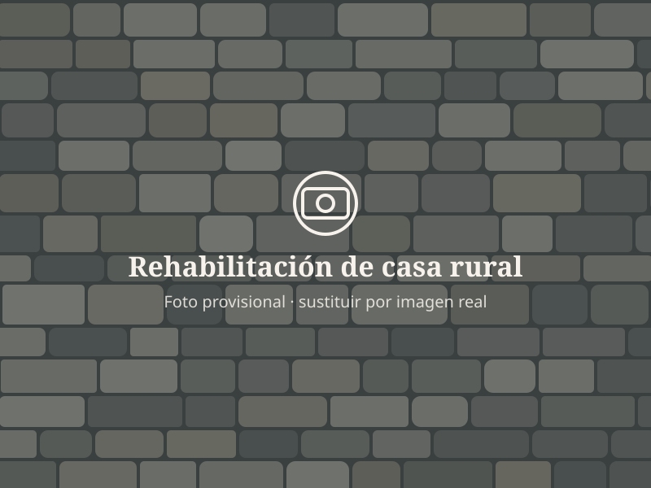
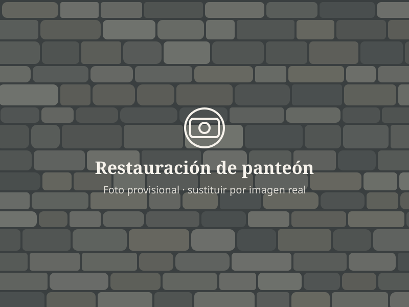
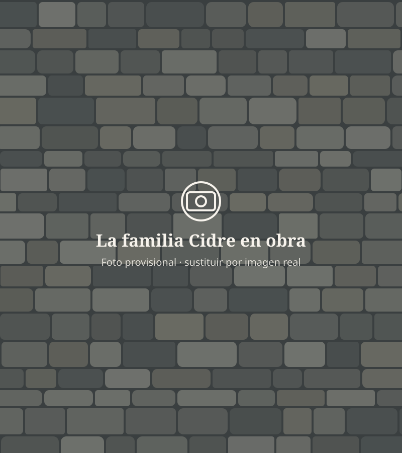

```{r}
#| label: setup
#| include: false
source("R/mapa_zona.R")
```

::: {#inicio .hero style="background-image: linear-gradient(100deg, rgba(30,39,43,.92) 0%, rgba(46,58,64,.78) 55%, rgba(46,58,64,.45) 100%), url(images/hero.svg);"}
::: container
[Empresa familiar · Escairón, O Saviñao]{.antetitulo}

# Construimos y reformamos con oficio, piedra a piedra {#titulo-principal .unnumbered}

[Albañilería, reformas y rehabilitación en Escairón, Monforte de Lemos y toda la Ribeira Sacra. Más de  años cuidando las casas de nuestros vecinos.]{.lema}

::: acciones
[<i class="bi bi-clipboard-check"></i>Pide presupuesto gratis](#contacto){.btn .btn-madera}
[<i class="bi bi-telephone-fill"></i>Llamar al ](tel:){.btn .btn-contorno}
:::

[<i class="bi bi-patch-check-fill"></i> Visita y presupuesto sin compromiso en toda la comarca]{.sello}
:::
:::

::: confianza
::: container
::: {.rejilla .rejilla-4}
::: dato
[+]{.cifra}
[años de oficio]{.etiqueta}
:::
::: dato
<i class="bi bi-house-heart"></i>
[Empresa familiar]{.etiqueta}
:::
::: dato
<i class="bi bi-cash-coin"></i>
[Presupuesto gratis]{.etiqueta}
:::
::: dato
<i class="bi bi-geo-alt"></i>
[Escairón – Monforte]{.etiqueta}
:::
:::
:::
:::

::: {#servicios .seccion}
::: container
::: text-center
[Qué hacemos]{.antetitulo}

## Servicios de albañilería y construcción {#titulo-servicios .unnumbered}

[Desde un pequeño arreglo hasta una casa nueva. Trabajamos con materiales de la zona y con el cuidado de quien trabaja para sus vecinos.]{.intro}
:::

::: {.rejilla .rejilla-3 .mt-4}
::: celda
::: servicio
[<i class="bi bi-house-gear"></i>]{.icono}

### Reformas integrales {.unnumbered}

Cocinas, baños y viviendas completas. Nos encargamos de todo para que tú solo tengas que elegir cómo la quieres.

- Baños y cocinas llave en mano
- Alicatados, solados y tabiquería
- Adaptación de baños (plato de ducha, accesibilidad)
:::
:::

::: celda
::: servicio
[<i class="bi bi-bricks"></i>]{.icono}

### Piedra y rehabilitación {.unnumbered}

Devolvemos la vida a casas de piedra, pajares y muros tradicionales respetando su carácter.

- Muros de mampostería y cachotería
- Rejuntado y limpieza de piedra
- Rehabilitación de casas rurales
:::
:::

::: celda
::: servicio
[<i class="bi bi-buildings"></i>]{.icono}

### Obra nueva {.unnumbered}

Viviendas, garajes, almacenes y ampliaciones, desde la cimentación hasta el remate final.

- Cimentaciones y estructura
- Ampliaciones y anexos
- Naves, garajes y alpendres
:::
:::

::: celda
::: servicio
[<i class="bi bi-house-up"></i>]{.icono}

### Tejados y exteriores {.unnumbered}

Cubiertas que aguantan el invierno gallego y exteriores pensados para durar.

- Tejados de pizarra y teja, goteras
- Fachadas, revocos y aislamiento
- Cierres de fincas, patios y pavimentos
:::
:::

::: celda
::: {.servicio .servicio-destacado}
[<i class="bi bi-flower1"></i>]{.icono}

### Trabajos en cementerios {.unnumbered}

Un trabajo que hacemos con especial respeto y discreción, acompañando a cada familia.

- Colocación de lápidas
- Construcción y arreglo de nichos
- Restauración de panteones
:::
:::

::: celda
::: servicio
[<i class="bi bi-tools"></i>]{.icono}

### Pequeñas obras y arreglos {.unnumbered}

Ningún trabajo es pequeño: humedades, grietas, chimeneas, escaleras o ese arreglo que llevas tiempo dejando.

- Reparación de humedades y grietas
- Chimeneas y barbacoas
- Mantenimiento de viviendas
:::
:::
:::
:::
:::

::: {#trabajos .seccion .seccion-alt}
::: container
::: text-center
[Nuestro trabajo]{.antetitulo}

## Trabajos realizados {#titulo-trabajos .unnumbered}

[Algunas de las obras que hemos hecho en la comarca. Pulsa en cada foto para verla en grande.]{.intro}
:::

::: {.rejilla .rejilla-3 .mt-4 .galeria}
::: celda
{group="trabajos"}
:::
::: celda
{group="trabajos"}
:::
::: celda
{group="trabajos"}
:::
::: celda
{group="trabajos"}
:::
::: celda
{group="trabajos"}
:::
::: celda
{group="trabajos"}
:::
:::
:::
:::

::: {#nosotros .seccion}
::: container
::: {.split .split-nosotros}
::: foto-familia
{fig-alt="La familia Cidre trabajando en una obra" .nolightbox}
:::

::: celda
[Quiénes somos]{.antetitulo}

## Una familia de albañiles de Escairón {#titulo-nosotros .unnumbered}

Construcciones y Reformas Cidre es una empresa familiar de O Saviñao. Desde  levantamos muros, tejados y casas en Escairón, Monforte de Lemos y los pueblos de alrededor, con un oficio que ha pasado de padres a hijos.

Conocemos la piedra de la Ribeira Sacra, el clima de aquí y las casas de aquí. Por eso cada obra la hacemos como si fuese para nosotros: bien hecha, limpia y a tiempo.

[«Aquí todo el mundo se conoce. Nuestra mejor publicidad es un vecino contento.»]{.cita}

::: valores
- <i class="bi bi-check-circle-fill"></i> <span>**Trato cercano y directo**: hablas siempre con quien hace la obra.</span>
- <i class="bi bi-check-circle-fill"></i> <span>**Palabra cumplida**: plazos y presupuestos claros, sin sorpresas.</span>
- <i class="bi bi-check-circle-fill"></i> <span>**Materiales y técnicas de la zona**: piedra, pizarra y madera bien trabajadas.</span>
- <i class="bi bi-check-circle-fill"></i> <span>**Obra limpia**: dejamos tu casa como nos gustaría encontrar la nuestra.</span>
:::
:::
:::
:::
:::

::: {#como-trabajamos .seccion .seccion-oscura}
::: container
::: text-center
[Sin complicaciones]{.antetitulo}

## Cómo trabajamos {#titulo-como .unnumbered}
:::

::: {.rejilla .rejilla-4 .mt-4}
::: paso
[1]{.numero}

### Nos llamas {.unnumbered}

Por teléfono o WhatsApp, nos cuentas qué necesitas.
:::
::: paso
[2]{.numero}

### Visitamos la obra {.unnumbered}

Vamos a verla sin compromiso y te asesoramos.
:::
::: paso
[3]{.numero}

### Presupuesto gratis {.unnumbered}

Te damos un precio claro y cerrado, por escrito.
:::
::: paso
[4]{.numero}

### Obra bien hecha {.unnumbered}

Trabajamos en plazo y te entregamos todo limpio.
:::
:::
:::
:::

::: {#zona .seccion .seccion-alt}
::: container
::: {.split .split-zona}
::: celda
[Dónde trabajamos]{.antetitulo}

## Escairón, Monforte y alrededores {#titulo-zona .unnumbered}

Tenemos la base en Escairón (O Saviñao) y trabajamos en un radio de unos 25 km: Monforte de Lemos, Chantada, Pantón, Sober, Taboada y el resto de la Ribeira Sacra.

¿Tu pueblo no aparece? Pregúntanos igualmente.

::: pueblos
- Escairón
- Monforte de Lemos
- Chantada
- Ferreira de Pantón
- Sober
- Taboada
- Bóveda
- Os Peares
- Carballedo
:::
:::

::: mapa
```{r}
#| label: mapa
mapa_zona()
```
:::
:::
:::
:::

::: {#contacto .seccion}
::: container
::: text-center
[Hablemos]{.antetitulo}

## Pide tu presupuesto sin compromiso {#titulo-contacto .unnumbered}

[Cuéntanos qué necesitas y te respondemos lo antes posible. La visita y el presupuesto son gratuitos.]{.intro}
:::

::: {.split .split-contacto .mt-4}
::: celda
::: {.rejilla .rejilla-2}
::: celda
::: contacto-tarjeta
<i class="bi bi-telephone-fill"></i>
<div>[Teléfono]{.tipo}
[](tel:)</div>
:::
:::
::: celda
::: contacto-tarjeta
<i class="bi bi-whatsapp"></i>
<div>[WhatsApp]{.tipo}
[Escríbenos](https://wa.me/?text=Hola%2C%20quer%C3%ADa%20pedir%20un%20presupuesto)</div>
:::
:::
::: celda
::: contacto-tarjeta
<i class="bi bi-envelope-fill"></i>
<div>[Correo electrónico]{.tipo}
[](mailto:?subject=Solicitud%20de%20presupuesto)</div>
:::
:::
::: celda
::: contacto-tarjeta
<i class="bi bi-clock-fill"></i>
<div>[Horario]{.tipo}
[]{.valor}</div>
:::
:::
::: {.celda .ancho-completo}
::: contacto-tarjeta
<i class="bi bi-geo-alt-fill"></i>
<div>[Dirección]{.tipo}
[]{.valor}</div>
:::
:::
:::
:::

::: celda
::: presupuesto-caja
### ¿Tienes una obra en mente? {.unnumbered}

Mándanos unas fotos por WhatsApp de lo que quieres hacer y te orientamos sobre el trabajo y el precio aproximado. Después pasamos a verlo sin ningún compromiso.

::: acciones
[<i class="bi bi-whatsapp"></i>Enviar WhatsApp](https://wa.me/?text=Hola%2C%20quer%C3%ADa%20pedir%20un%20presupuesto){.btn .btn-madera}
[<i class="bi bi-telephone-fill"></i>Llamar](tel:){.btn .btn-contorno}
:::
:::
:::
:::
:::
:::

::: pie
::: {.container .text-center}
[]{.marca}

Albañilería, reformas y rehabilitación · Escairón (O Saviñao), Lugo

[](tel:) · [](mailto:)

© 2026 
:::
:::

[<i class="bi bi-whatsapp"></i>](https://wa.me/?text=Hola%2C%20quer%C3%ADa%20pedir%20un%20presupuesto){.whatsapp-flotante aria-label="Escríbenos por WhatsApp"}
